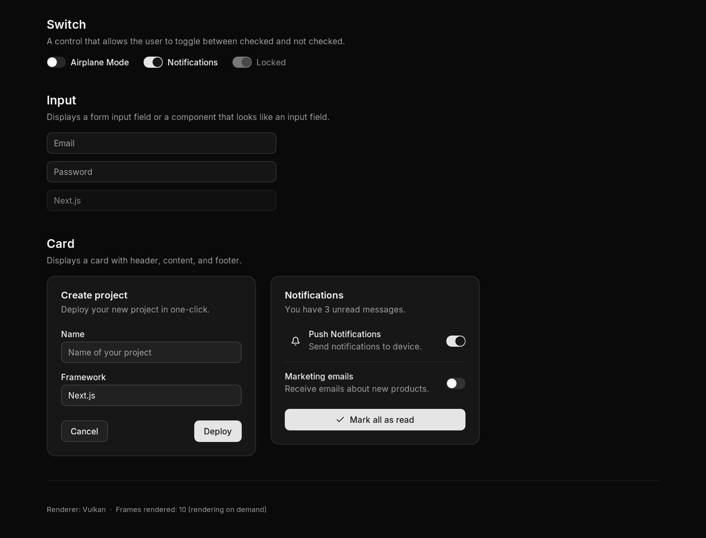

# Silta

[](https://github.com/seregonwar/Silta/actions/workflows/verify.yml)
[](https://github.com/seregonwar/Silta/actions/workflows/nightly.yml)
[](LICENSE)

**A native C++20 design system inspired by shadcn/ui, built on Dear ImGui.**

Silta brings consistent typography, theme tokens, flexible layouts and reusable
components to native applications. Its components draw through `ImDrawList`;
applications can use the supplied windowing shell or integrate Silta into an
existing render loop.



## Features

- **Token-based theming.** Light and dark themes across neutral, zinc, slate,
  stone and gray palettes. OKLCH colors, semantic tokens and configurable accents.
- **Flexible layout.** Rows and columns with spacing, padding, alignment,
  justification, flexible sizing and responsive breakpoints.
- **Consistent presentation.** Inter typography, rounded borders, shadows,
  focus rings and animated state transitions.
- **Native application shell.** GLFW windows, Direct3D 11 and Vulkan backends,
  runtime renderer switching, file dialogs, drag-and-drop and PNG screenshots.
- **Rendering on demand.** The shell waits for input when no animation or
  scheduled update requires another frame.
- **Application examples.** A component gallery, a minimal form and Silta Cut,
  a multitrack video editing example with audio/video playback and MP4 export.

## Getting started

### Requirements

- CMake 3.24 or newer.
- A C++20 compiler. The Windows build uses Visual Studio 2022 with the Desktop
  development with C++ workload and Windows SDK.
- Git and network access for the first configuration. Dear ImGui 1.92.9b,
  FreeType 2.13.3 and GLFW 3.4 are fetched at pinned versions.
- The Vulkan SDK when building the Vulkan backend. Direct3D 11 requires no
  additional graphics SDK beyond the Windows SDK.

### Build the Windows examples

```powershell
git clone https://github.com/seregonwar/Silta.git
cd Silta
cmake -S . -B build/win -G "Visual Studio 17 2022" -A x64 -DSILTA_RENDERER_VULKAN=OFF
cmake --build build/win --config Release --parallel 2
./build/win/examples/gallery/Release/silta_gallery.exe
```

Fonts are copied beside the example executables. To enable Vulkan, install its
SDK and configure with `-DSILTA_RENDERER_VULKAN=ON`.

### Use Silta in an application

Add the repository as a CMake subdirectory and link the application shell:

```cmake
set(SILTA_EXAMPLES OFF CACHE BOOL "" FORCE)
add_subdirectory(external/Silta)
target_link_libraries(my_app PRIVATE Silta::app)
```

```cpp
#include "silta/app.hpp"
#include "silta/silta.hpp"
#include <string>

int main() {
    silta::App app({.title = "My application"});
    if (!app.ok()) return 1;

    std::string name;
    return app.run([&] {
        auto page = silta::Column({.gap = 16, .padding = silta::Edges::all(32)});
        silta::Text("Create a project", {.size = silta::TextSize::xl,
                                         .weight = silta::Weight::semibold});
        silta::Input("name", &name, {.placeholder = "Project name", .width = 320});
        if (silta::Button("Create project")) {
            silta::toast("Project created", {.kind = silta::ToastKind::success});
        }
        silta::Toaster();
    });
}
```

For an application with an existing window and renderer, link `Silta::silta`,
call `silta::init()` after creating the ImGui context, and wrap UI work in
`silta::begin_frame()` / `silta::end_frame()` inside the application's ImGui
frame. Call `silta::shutdown()` before destroying the ImGui context. Components
use Silta's drawing and styling; ImGui provides input, IDs, draw lists and text
editing infrastructure.

## Components

| Area | Components |
| --- | --- |
| Actions | Button, Toggle, ToggleGroup |
| Forms | Input, Checkbox, Switch, Slider, Select |
| Content | Text, Label, Badge, Card, Separator, Kbd |
| Navigation | Tabs, DropdownMenu |
| Overlays | Dialog, Popover, Tooltip |
| Feedback | Progress, toast / Toaster |
| Layout | Row, Column, Spacer, ScrollArea, Split |
| Media | Texture, Image, vector icons |

Headers in [`include/silta`](include/silta) expose component options. The
[Gallery](examples/gallery) demonstrates variants, sizes, themes, overlays and
renderer switching.

## Silta Cut

[Silta Cut](examples/editor) demonstrates a more complete application: two video
and two audio tracks, background thumbnails and waveforms, playback, trimming,
splitting, clip movement, undo/redo, volume, opacity and MP4 export.

It requires the FFmpeg shared development distribution under
`third_party/ffmpeg`, including headers, import libraries and runtime DLLs.
The exact distribution used by CI is recorded in
[the dependency manifest](.github/dependencies/ffmpeg.json).
miniaudio 0.11.23 is fetched and verified automatically during configuration.

```powershell
# In a clean checkout, download the same verified FFmpeg distribution as CI:
./.github/scripts/setup-ffmpeg.ps1
cmake -S . -B build/win -DSILTA_EDITOR=ON -DSILTA_RENDERER_VULKAN=OFF
cmake --build build/win --config Release --parallel 2
./build/win/examples/editor/Release/silta_cut.exe
```

See the [editor guide](examples/editor/README.md) for shortcuts, scripted testing
and current limitations. Projects are currently held in memory; project
save/load is not implemented.

## Build options

| Option | Default | Purpose |
| --- | --- | --- |
| `SILTA_FREETYPE` | `ON` | Use FreeType to rasterize text |
| `SILTA_APP` | `ON` | Build the window and renderer shell |
| `SILTA_EXAMPLES` | `ON` for a top-level build | Build Gallery and Hello |
| `SILTA_EDITOR` | `OFF` | Build Silta Cut and its test executables |
| `SILTA_RENDERER_D3D11` | `ON` on Windows | Compile the Direct3D 11 backend |
| `SILTA_RENDERER_VULKAN` | `ON` | Compile Vulkan when its SDK is found |
| `BUILD_TESTING` | `ON` | Build and register renderer-free core tests |

The renderer-free library can be built separately, including on Linux and macOS:

```sh
cmake -S . -B build/core -DSILTA_APP=OFF -DSILTA_EXAMPLES=OFF -DBUILD_TESTING=ON
cmake --build build/core --config Release --parallel 2
ctest --test-dir build/core -C Release --output-on-failure
```

## Verification and nightly builds

[Verify](.github/workflows/verify.yml) runs on **every push**, pull request and
manual dispatch. It validates the workflow files, builds and tests the core on
Windows, Linux and macOS, covers text rendering with and without FreeType, and
builds the Windows applications. Windows checks exercise Gallery screenshots,
media decoding, editing operations, playback, compositing, MP4 export and export
cancellation. Logs, screenshots and verified packages are retained as artifacts.

[Nightly](.github/workflows/nightly.yml) runs daily at **02:17 UTC** and can also
be started manually on the default branch. It reruns the same verification
before publishing a Windows x64 prerelease. Each snapshot has a dated,
commit-specific tag and includes application binaries, fonts, runtime DLLs,
third-party notices, a source archive and SHA-256 checksums. Existing snapshots
are preserved. Nightlies use Direct3D 11 and are intended for evaluation.

Download snapshots from [Releases](https://github.com/seregonwar/Silta/releases).
Extract the archive before launching an executable. Nightly publication starts
after the workflows are committed to the default branch and GitHub Actions is
enabled for the repository.

To run the editor checks locally after building the test executables:

```powershell
./examples/editor/smoke.ps1 -BuildDirectory build/win
```

The Gallery also accepts `--hidden`, `--dark`, `--base=zinc`,
`--backend=d3d11|vulkan`, `--switch-to=vulkan|d3d11`, and an input script:

```powershell
./build/win/examples/gallery/Release/silta_gallery.exe --hidden --script="sleep:300;shot:gallery.png;quit"
```

Set `SILTA_TRACE` to a file path to record render-loop diagnostics.

## Project structure

```text
include/silta/     Public API and component headers
src/              Themes, layout, drawing, animation and components
src/app/          Windowing, native dialogs and renderer backends
examples/hello/   Minimal application
examples/gallery/ Component showcase
examples/editor/  Silta Cut and media tests
tests/            Renderer-free regression tests
assets/fonts/     Inter fonts and their license
docs/screenshots/ Gallery screenshots
.github/          Verification, nightly builds and dependency manifest
```

## Status and contributing

Silta is an early-stage project, currently version 0.1. The desktop application
shell has been exercised on Windows with Direct3D 11 and Vulkan. Core library
builds are checked separately on Linux and macOS; their native application shells
and file dialogs are not complete. Metal, accessibility support, overlay exit
animations and a C ABI/Rust binding remain future work.

Bug reports and focused pull requests are welcome. Include the compiler,
renderer, reproduction steps and relevant logs with a report. For a code change,
run the core tests and the affected example before submitting it.

## License

Silta's original code is distributed under the [MIT License](LICENSE).
Dependencies and fonts retain their own licenses; see
[third-party notices](THIRD_PARTY.md).
